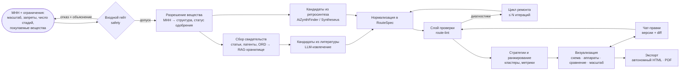
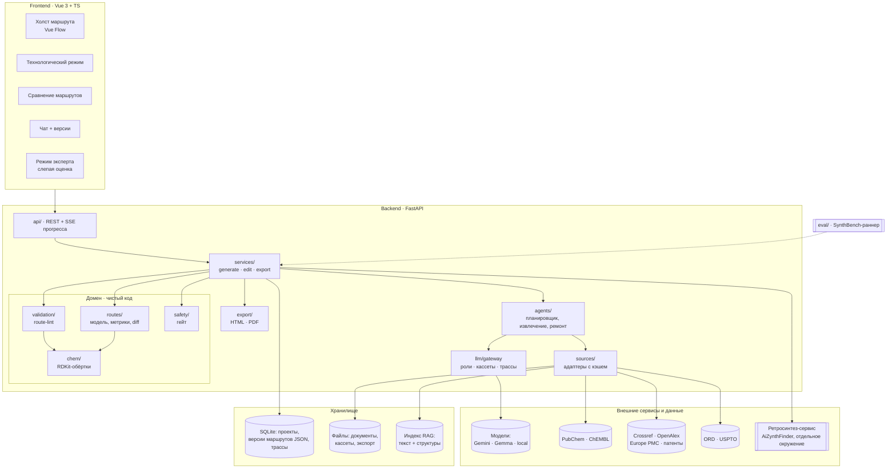

# Архитектура решения (этап 1, блок 3)

- **Статус:** черновик v0.1 · 2026-10-13
- **Связанные решения:** ADR-0001 (правила как код), ADR-0002 (генерация под контролем верификаторов), ADR-0003 (RouteSpec)

## 1. Видение: процесс целиком

**Где работает модель, а где код.** LLM извлекает данные из литературы, предлагает кандидатов, ремонтирует их по диагностикам и ведёт диалог.
Всё, что даёт статус «подтверждено», делает детерминированный код: гейт, разрешение структур, проверки, метрики, ранжирование, экспорт (TRUST-003).

## 2. Компонентная архитектура

Слои импортируются только сверху вниз, домен не знает про HTTP и LLM (PY-004). Ретросинтез вынесен в отдельный процесс:
у AiZynthFinder свои пины зависимостей (Python < 3.13, старые `rdkit`/`numpy`), см. `docs/research/04-models-and-environment.md`.

## 3. Модули: зачем, что на входе и выходе, ожидаемый результат

| # | Модуль | Почему отдельный | Вход → выход | Ожидаемый результат |
|---|---|---|---|---|
| 1 | **safety** — входной гейт | обязательное требование ТЗ, fail-closed, отдельное ревью | МНН → допуск или отказ с причиной | 100% запросов проходят гейт до генерации |
| 2 | **sources** — адаптеры данных | ненадёжная сеть, лимиты и лицензии изолированы | идентификатор → нормализованная запись + provenance | кэшируемый доступ к PubChem, ChEMBL, литературе, ORD |
| 3 | **chem** — химическое ядро | детерминированные чистые функции на RDKit | SMILES → каноническая структура, InChIKey, формула | единая идентичность веществ по всей системе |
| 4 | **RouteSpec** — формат и `routes` | публичный контракт между всеми модулями | JSON ↔ доменная модель, diff версий | один формат для бэкенда, UI, экспорта и бенчмарка |
| 5 | **validation (route-lint)** | ядро доверия и главной метрики | RouteSpec → диагностики со статусами | доля валидных шагов считается для любого маршрута |
| 6 | **llm** — gateway | смена модели конфигом, лимиты, кассеты, стоимость | роль + промпт + схема → структурированный ответ + трасса | воспроизводимые прогоны, учёт стоимости |
| 7 | **agents** — генерация | оркестрация LLM-шагов отделена от домена | МНН + свидетельства → кандидаты RouteSpec | набор разных стратегий с источниками |
| 8 | **retro** — ретросинтез-сервис | тяжёлые зависимости, отдельное окружение | целевая структура → деревья маршрутов | кандидаты, не зависящие от LLM, плюс baseline |
| 9 | **RAG** — хранилище знаний | литература большая, а нужна цитируемость | запрос → фрагменты с DOI или патентом и цитатой | каждый факт привязан к проверяемому фрагменту |
| 10 | **frontend** | визуализация доверия является частью продукта | RouteSpec → схема, сравнение, режимы масштаба | профессионал за 10 секунд видит, чему верить |
| 11 | **chat + версии** | правки должны быть прозрачными | реплика → новая версия + diff + повторная проверка | история изменений с ответом на вопрос «кто и что поменял» |
| 12 | **export** | автономность и печать | версия маршрута → HTML (offline) и PDF | отчёт открывается без сети, дисклеймер на месте |
| 13 | **eval** — бенчмарк | научный результат и защита от регрессий | конфигурация → метрики с доверительными интервалами | сравнение с LLM без обвязки по точности и цене |

## 4. Сквозные требования

- **Доверие:** у каждого факта есть `provenance` и `verification` (TRUST-001…007).
- **Модель как конфигурация:** роли `planner`, `extractor`, `classifier`, `chat`, `embeddings` и профили провайдеров (`free`, `paid`, `local`) задаются в конфиге (LLM-002).
- **Воспроизводимость:** кассеты LLM, `modelVersion` в трассе, результаты прогонов с `git_sha` (LLM-006, EVAL-001).
- **Наблюдаемость:** трасса на каждый прогон с токенами, стоимостью, латентностью и версиями промптов и проверок (LLM-005).
- **Ошибки:** пользователь получает понятное действие, а подробности уходят в лог (CORE-007).

## 5. Технологии (кандидаты, решения фиксируются ADR после спайков)

| Слой | Выбор | Почему |
|---|---|---|
| Бэкенд | Python 3.12, FastAPI, Pydantic v2, SQLAlchemy async + SQLite | рекомендация программы; совместимость с RDKit и AiZynthFinder |
| Химия | RDKit; RXNMapper для картирования атомов | стандарт отрасли, открытые |
| Ретросинтез | AiZynthFinder (основной), Syntheseus (сравнение одношаговых моделей) | открытые, работают на CPU; ASKCOS v2 требует x86 и ≥ 32 GB RAM |
| LLM | свой `gateway` поверх PydanticAI; кассеты через vcrpy | структурированный вывод, смена провайдера, запись ответов |
| RAG | SQLite FTS5 (BM25) + векторный индекс + поиск по InChIKey | гибридный поиск с привязкой к структурам |
| Фронтенд | Vue 3, TypeScript, Vue Flow | требование ТЗ |
| Экспорт | Vite single-file сборка + Playwright → PDF | один рендер для HTML и PDF |

## 6. Риски и компромиссы

| Риск | Влияние | Что делаем |
|---|---|---|
| Лимиты и доступность бесплатного тира моделей | срыв прогонов | профили провайдеров, кассеты, rate limiter, локальные Gemma на Kaggle |
| Политика данных free tier (запросы могут использоваться провайдером) | лицензированные тексты нельзя отправлять | через free tier идут только открытые данные |
| Конфликт зависимостей ретросинтеза | хрупкое окружение | отдельный сервис или контейнер |
| Неполнота открытых данных о маршрутах | низкий recall | гибрид литературы и ретросинтеза; честный отчёт о покрытии |
| Дрейф версий моделей | невоспроизводимые числа | `modelVersion` в трассе, кассеты, замороженные локальные модели для статьи |
