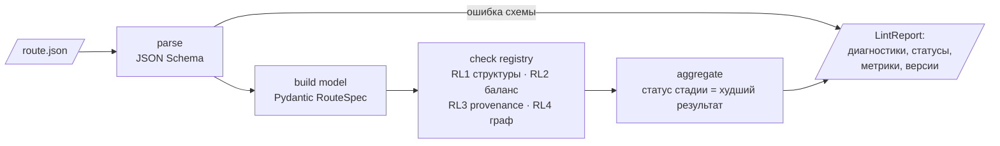

# Фича 001: route-lint v0 — детерминированная проверка маршрута

- **Статус:** предложено (этап 1, блок 7) · 2026-10-13
- **Связанные правила:** TRUST-001…006, SCHEMA-001…005, PY-008 · **ADR:** 0002, 0003

## 1. Что это

Библиотека и CLI, которые принимают маршрут в формате RouteSpec и возвращают **диагностики с кодами**
и **статус каждой стадии**, по аналогии с линтером кода. Модель здесь не участвует вообще: это чистый детерминированный код на RDKit.

```bash
route-lint route.json                 # человекочитаемый отчёт
route-lint route.json --format json   # машиночитаемый (для UI, eval и цикла ремонта)
route-lint route.json --format sarif  # позже: для интеграции с IDE и CI
```

## 2. Видение

Это **«компилятор» для маршрутов синтеза**. Любой маршрут, кем бы он ни был предложен (LLM, ретросинтетический движок, человек или
импорт из AiZynthFinder), проходит одни и те же проверки и получает одинаково понятный результат:

```
route.json: 3 стадии · валидны 2/3
  S1  ✓ computed     все обязательные проверки пройдены
  S2  ? hypothesis   RL201 (предупреждение) строгий баланс не сходится: не хватает {O: 1, H: 2}
                     подсказка: возможно, не указан побочный продукт H2O
                     RL301 у стадии нет источника → статус не выше hypothesis
  S3  ✗ failed       RL203 в продукте есть тяжёлые атомы, которых нет в реагентах: {C: 2, O: 1}
```

Позже эти же диагностики:
- показываются в UI как бейджи на рёбрах схемы;
- уходят в LLM в цикле ремонта;
- агрегируются в главную метрику бенчмарка.

## 3. Объём v0 (минимальный проверяемый)

| Код | Проверка | Как | Статус при провале |
|---|---|---|---|
| RL0xx | документ соответствует JSON Schema RouteSpec v0.1 | `jsonschema` (draft 2020-12) | документ отклонён целиком |
| RL1xx | структуры валидны: SMILES парсится и санитизируется, InChIKey совпадает с заявленным | RDKit `MolFromSmiles`, `SanitizeMol`, `MolToInchiKey` | `failed` |
| RL2xx | **двухуровневый** баланс с учётом стехиометрии: (1) тяжёлые атомы продукта должны происходить из заявленных реагентов (RL203, блокирует); (2) строгий баланс атомов и заряда (RL201/RL202, предупреждение с подсказкой о малых побочных продуктах) | RDKit: подсчёт элементов и формального заряда | (1) `failed`; (2) предупреждение. Почему так: в базах реакции в большинстве несбалансированы (менее 12% одностадийных реакций Reaxys сбалансированы, `docs/research/01-problem-and-metrics.md` [95]), и строгая проверка забраковала бы почти всю литературу |
| RL3xx | происхождение: у стадии есть источник или явная пометка «гипотеза модели» | правило над полем `provenance` | статус не выше `hypothesis` |
| RL4xx | ссылочная целостность: стадии ссылаются на существующие вещества, граф связен и ведёт к целевой субстанции | обход графа | `failed` |

Не входит в v0, следующие итерации: картирование атомов и соответствие шаблонам (RXNMapper), прямое предсказание,
доступность сырья, классы ICH Q3C и Q3D, флаги опасности, PMI и E-factor, проверка цитат (DOI и цитата в тексте).

## 4. Архитектура фичи



- **Компоненты:** `validation/registry.py` регистрирует проверки (каждая имеет `check_id` и `version`);
  `validation/checks/*.py` содержит чистые функции `(Route) → list[Diagnostic]`; `chem/` обёртывает RDKit; `cli.py`.
- **Вход:** RouteSpec v0.1 (`schemas/route/v0.1/route.schema.json`).
- **Выход:** `LintReport { route_id, steps: [{step_id, status, diagnostics[]}], summary: {valid_steps, total_steps}, tool_versions }`.
  Это поле `verification` из TRUST-005.
- **Где работает модель:** нигде. Модель потребляет диагностики только позже, в цикле ремонта (ADR-0002). Именно поэтому
  route-lint годится как независимый измеритель качества любых генераторов.

## 5. Почему эта фича первая

1. **Даёт главную метрику с первого дня.** «Доля шагов, проходящих детерминированные проверки» — первая метрика успеха из ТЗ.
   Без route-lint нельзя измерить ни baseline «LLM без обвязки», ни прогресс.
2. **От неё зависят все остальные модули:** статусы в UI, цикл ремонта, ранжирование, экспорт, бенчмарк.
3. **Не зависит от UI, лимитов моделей и сбора литературы.** Её можно сделать и полностью покрыть тестами за 1–2 недели.
4. **Это ядро open source** (`docs/vision/north-star.md`): переиспользуемый инструмент, а не часть одной платформы.
5. **Минимальный риск:** RDKit — зрелая библиотека, проверки детерминированы и тестируются на синтетических примерах.

## 6. Критерии готовности

- [ ] RouteSpec v0.1: схема, валидные и невалидные примеры (SCHEMA-003).
- [ ] Проверки RL0–RL4: для каждой есть позитивный, негативный и граничный тест (PY-008); покрытие `validation/` ≥ 90%.
- [ ] CLI с текстовым и JSON-выводом; в отчёте указаны версии проверок и RDKit (TRUST-005).
- [ ] Первый замер: route-lint на маршрутах, сгенерированных LLM без обвязки (кассеты) → **первая цифра baseline** для отчёта этапа 2.

## 7. Спайк этапа 1

Осуществимость подтверждена спайком `spikes/route_lint_v0.py`: схема RouteSpec v0.1 и проверки RL1, RL2 и RL3
на игрушечных примерах формата. Результат приведён в отчёте недели.
